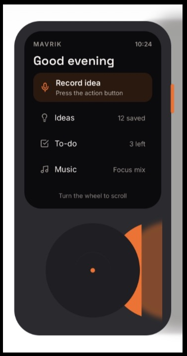
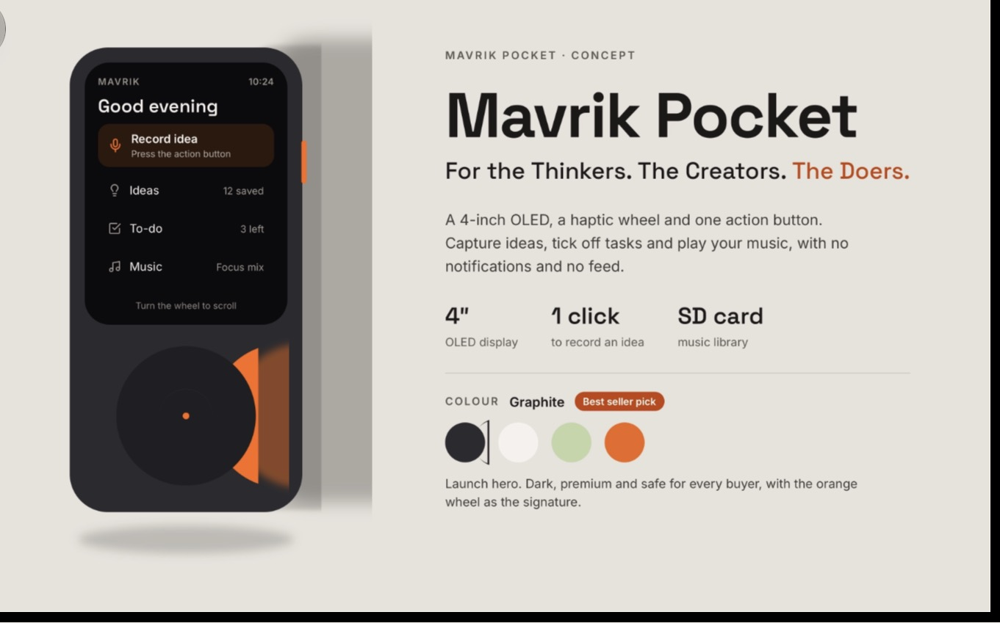
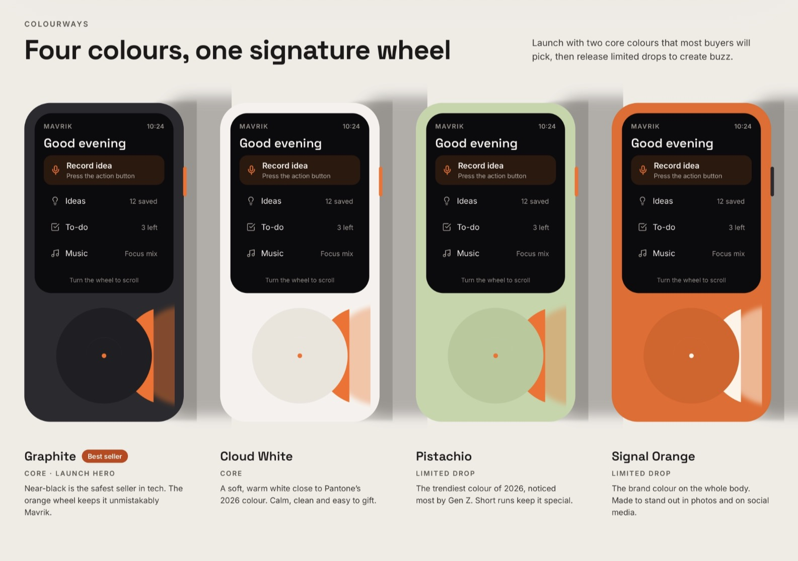
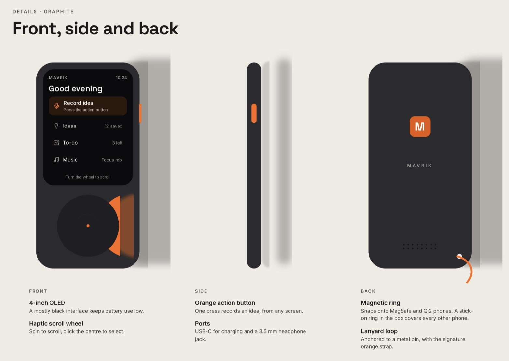
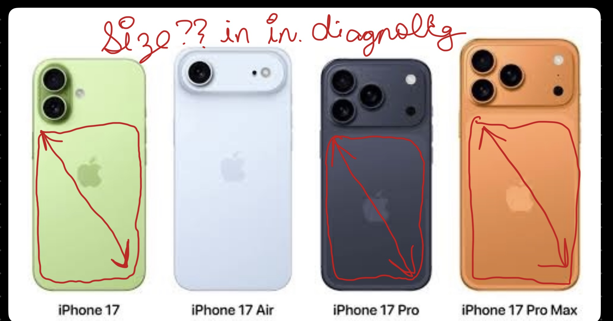
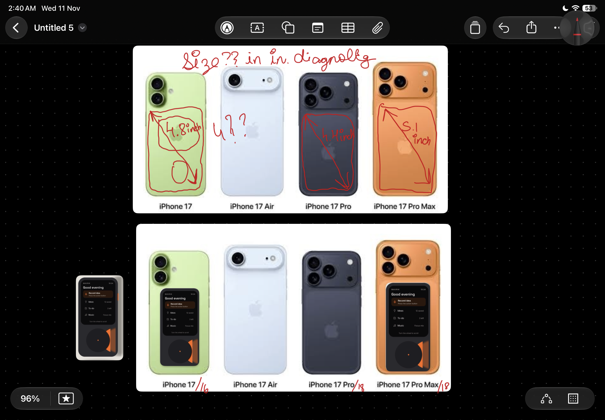
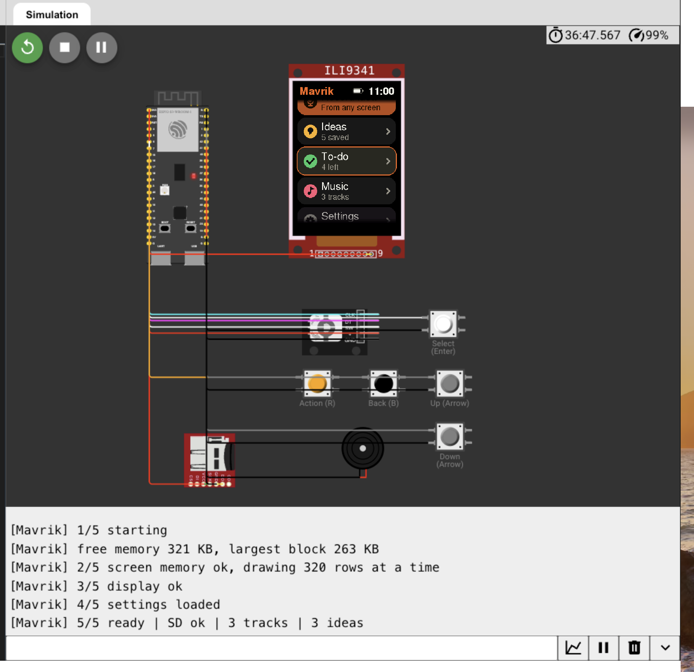
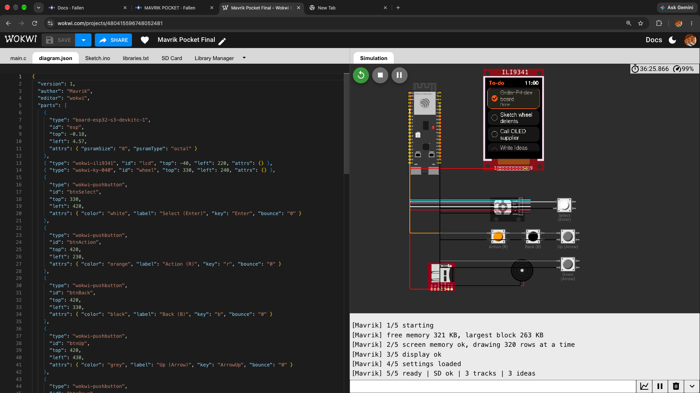

Hi People!!
My name is Atharv and I am from India and the project I am going to make irl is caleed Mavrik Pocket so its a very normal looking yet powerful product so its size is lil bit more taller and wider then a regular credit card and the main purpose of the device is that, so It's a pocket-sized AI recorder that listens to your meetings, phone calls, or chats and automatically writes down the notes and summaries for you and it works even offline and user can get AI insights over any thing they recorded throughout the day on the app on their phone so like people can still record, save ideas, enter there To-Do lists, listen to songs and each and everything works in 100% offline even without the phone bbut if the people want the AI insights and syncing there To-Do list across thir devices so that too is possible and the crazy thing is we fit all that and now it sits around just 9-10mm and this also attaches magnetically behind your Phone so there is no issue in carrying and accesisbility and the battery lasts more than 3 days. SO peole can start recording thier ideas or thought in just a click of a button and a super smooth scrolling wheel in center just below the screen like a Ipod which also has Haptics that feel from straight out from your Iphone and our main purpose is to get your things done remind you and keep you distraction free so Mavrik Pocket comes with no other apps notification except from your To-Do list to keep you distraction free and we achieve all this because we will be having our own UI and Operating system designed specially for achievening this. And I just dont limit my vision for this thing till just as a Project I am planning it to actually launch it as a proper product from my Brand and launch the pre-booking for this btw you can also check my main brand which is Mavrik AI Studio so I will launch this as a Product ffrom that company. BTW I am very very grateful that I came across you guys and hackclub because this oppourtunity forced me into thinking into even new fields and seriously guys I learned a lot in past week  compared to I learned in the past whole month and it kindaa felt as neurons in head started again to work :) and guys if you want to know more about who I am you can check the repost section of Hackclub and there you can easily spot me as Hack club reposted my reel on Instagram and my id is "atharv does it" and I also shared my journey there.

Thanks for giving me this oppourtunity to think on new things!!
-Atharv Singh (15 y/o)

  

<h1 align="center">Mavrik Pocket</h1>

For the Thinkers. The Creators. The Doers.

## Concept

## Colours

## Front, side and back

## Size on the back of an iPhone

## Mavrik OS running in Wokwi

ESP32-S3 (16 MB flash, 8 MB RAM) with a 2.8" 240×320 screen.

## Firmware

Mavrik OS 0.2 for the ESP32-S3 prototype is in [`Firmware/MavrikOS`](Firmware/MavrikOS). It compiles for the ESP32-S3, but hasn't been run on the real hardware yet.

- Records ideas from the INMP441 mic to the microSD card
- Plays ideas and music through the MAX98357A amp and speaker
- Scrolls with the rotary encoder or an iPod-style copper touch wheel
- Haptic ticks from a vibration motor
- Optional Wi-Fi for the clock and for turning ideas into text

Build steps, the wiring table and the SD card layout are in the [firmware README](Firmware/MavrikOS/README.md). Pins and options are in [`mavrik_config.h`](Firmware/MavrikOS/mavrik_config.h).

| File | What it does |
|---|---|
| [`MavrikOS.ino`](Firmware/MavrikOS/MavrikOS.ino) | The OS: Home, Record idea, Ideas, To-do, Music, Settings, About |
| [`mavrik_audio.h`](Firmware/MavrikOS/mavrik_audio.h) | Recording and playback |
| [`mavrik_touchwheel.h`](Firmware/MavrikOS/mavrik_touchwheel.h) | Touch wheel |
| [`mavrik_net.h`](Firmware/MavrikOS/mavrik_net.h) | Wi-Fi clock and transcription |

The Wokwi version of the OS is [`sketch.ino`](sketch.ino), with the circuit in [`diagram.json`](diagram.json).

## CAD

All 3D files are in [`STEP Files`](STEP%20Files).

| Build | Size | Project file | Full assembly |
|---|---|---|---|
| 8 mm concept | 58 × 112 × 8 mm | [FreeCAD](STEP%20Files/Concept%208mm/Mavrik_Pocket_Concept_8mm.FCStd) | [STEP](STEP%20Files/Concept%208mm/00_full_assembly.step) |
| Prototype case | 64 × 140 × 26 mm | [FreeCAD](STEP%20Files/Prototype%20case/Mavrik_Pocket_Prototype_Case.FCStd) | [STEP](STEP%20Files/Prototype%20case/00_full_assembly.step) |

Each part also has its own STEP file. Files starting with `ref_` are models of the electronics (screen, board, battery, mic, amp, speaker and so on), there to check that everything fits.

## Bill of materials

The full list, with a link to every item, is in [`BOM.csv`](BOM.csv). Things I already own are listed too, at ₹0.

- **Electronics, parts and tools from Quartz Components:** ₹2,227 before GST, about ₹2,628 with it.
- **Sold out at Quartz:** the mic and amp come from Robo Bazar (₹214) and the encoder from Probots (₹89).
- **Enclosure:** SLA resin print from the STEP files, about ₹2,000 with shipping (estimate). Then wet-sanded, primed and sprayed satin, with a clear acrylic screen window, for a finish close to an iPhone (about ₹480, estimate).
- **Total:** about ₹5,400, before shipping on the small orders.

To keep the cost down, I'm buying only the quantity I need, using a ₹114 soldering iron, and using a perfboard instead of a custom PCB for this prototype. When I make a PCB, I'll pick the cheapest options: HASL finish, 2 layers, 1.6 mm, green.
